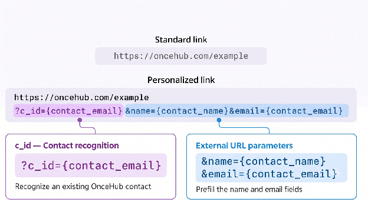

Personalize the scheduling experience for your guests and maximize booking efficiency by using custom URL parameters. URL parameters can prefill Booking Form questions and configure additional booking link behaviors, such as skipping the Booking Form step during scheduling.

---

## URL Parameter Categories

URL parameters for Booking Calendars are grouped into three main categories:

1. **Contact Properties:** Identify an existing OnceHub Contact with `c_id`, or prefill the booking form with external URL parameters that pass data from an outside source, such as a CRM or web form. You can also control whether guests see or skip the booking form.
2. **Meeting Configuration Parameters:** Dynamically adjust meeting settings, such as locking the host, adding co-hosts, setting the default guest time zone, or locking meeting durations.
3. **Tracking Parameters:** Capture UTM tags and hidden field data for tracking and reporting without altering meeting configurations or guest form fields.

---

## How to Add URL Parameters to Your Booking Links

Follow the steps below to add URL parameters to your Booking links:

1. Start with your base Booking link: `https://oncehub.com/example`
2. Add a query separator (`?`) at the end of the Booking link: `https://oncehub.com/example?`
3. Add your first parameter after the query separator: `https://oncehub.com/example?name=XXXX`
4. If adding multiple parameters, separate each parameter with an ampersand (`&`): `https://oncehub.com/example?name=XXXX&email=XXXX`

---

## URL Parameters Processing Rules

The following processing rules apply to all URL parameters:

- **Space encoding:** Encode all spaces within parameter values as `%20`. For example, for John Doe, use `name=John%20Doe`.
- **Parameter key casing:** Parameter keys are not case-sensitive. For example, `Name=John` is treated the same as `name=John`.
- **Parameter value casing:** Parameter values are case-sensitive. For example, `John` is treated as a different value from `john`.

---

## Combining Parameters

You can combine parameters from different categories in the same link.

Combining `c_id` with external URL parameters lets you associate the booking with an existing Contact in OnceHub while also passing live prefill values, meeting configurations, or tracking data through the URL.

For example, this link identifies an existing Contact, passes the guest's company from an external source, sets the meeting duration, and records the traffic source:

`https://oncehub.com/example?c_id=CTC-xxxxxxxxxxxxxx&company=Acme%20Corp&duration_minutes=15&utm_source=newsletter`

- `c_id` and `company`: Contact Properties and Booking Form fields
- `duration_minutes`: Meeting Configuration
- `utm_source`: Tracking

